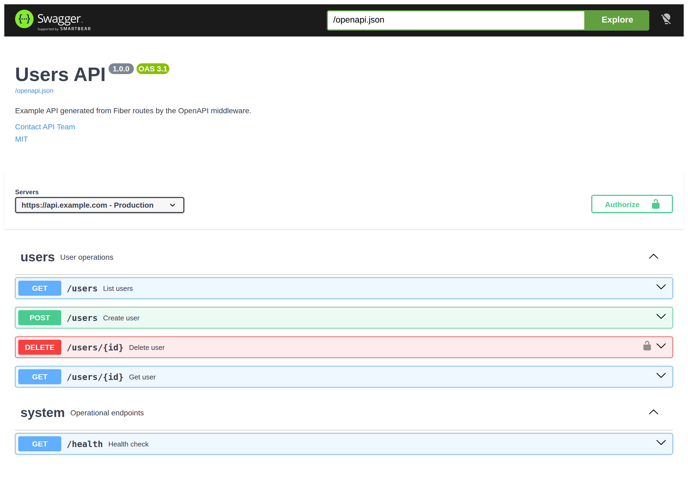
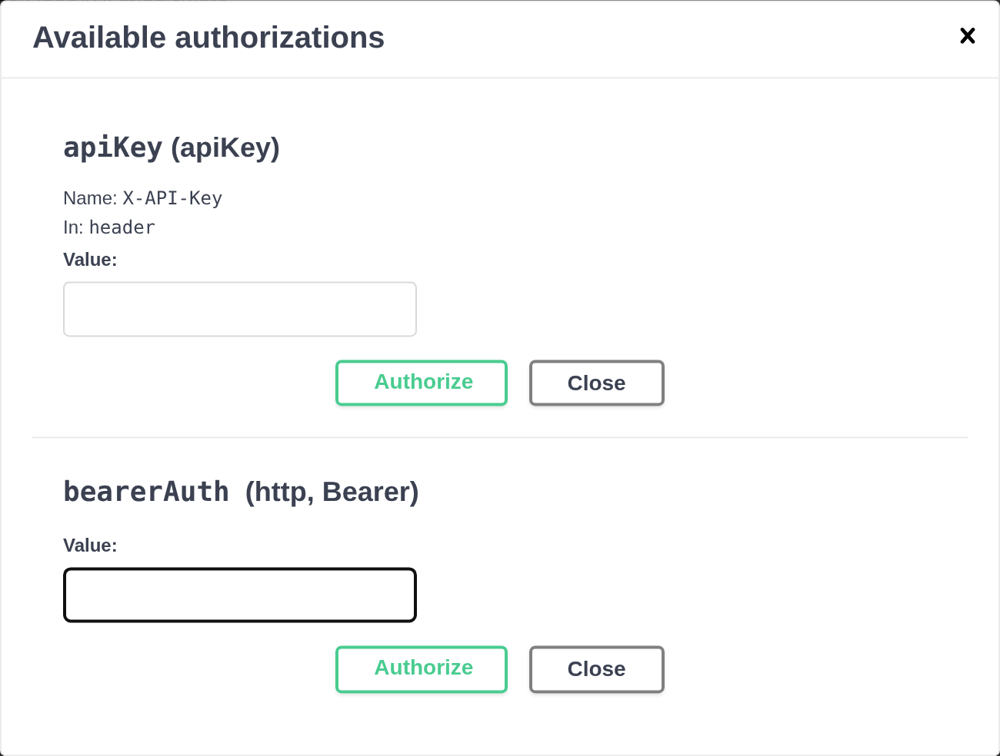
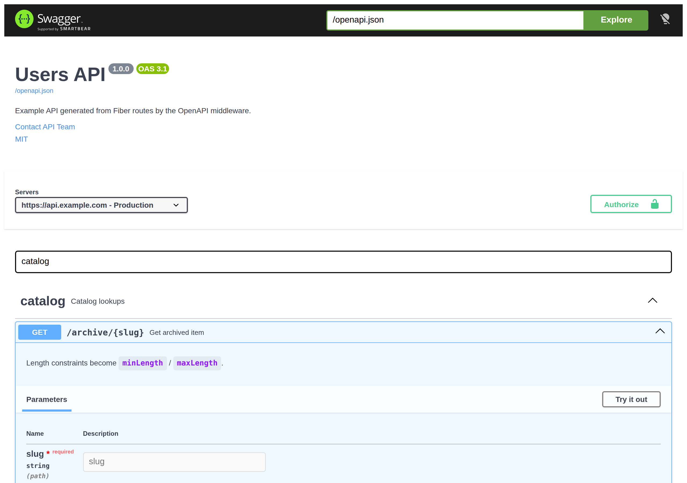
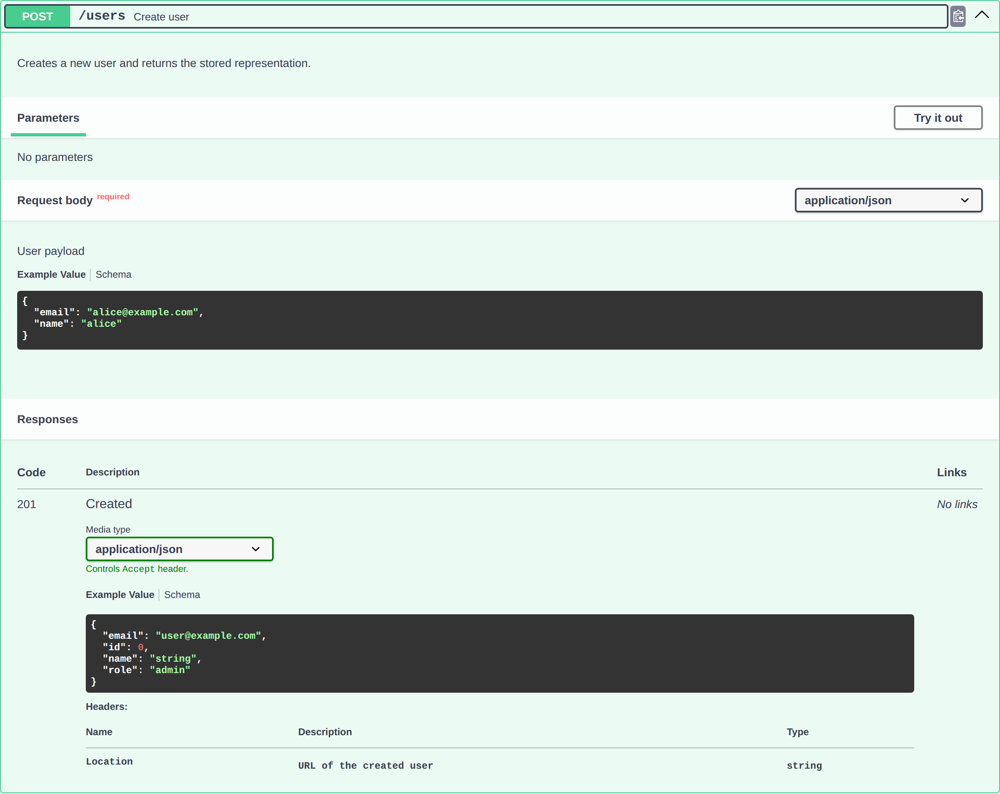
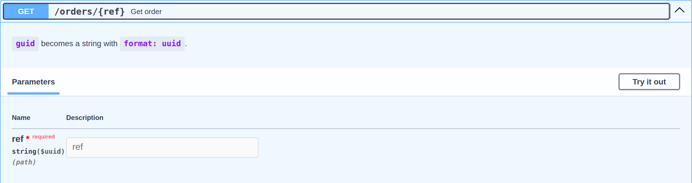
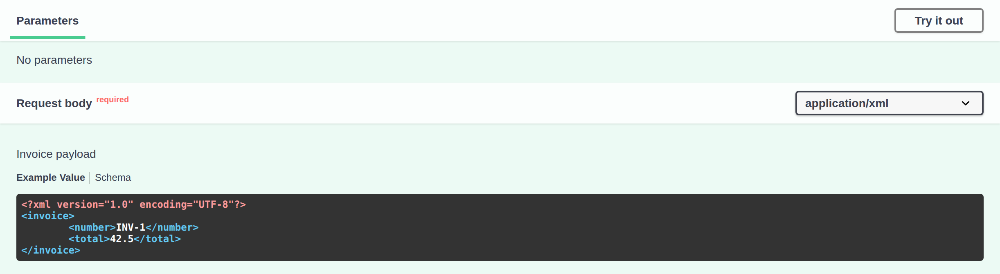
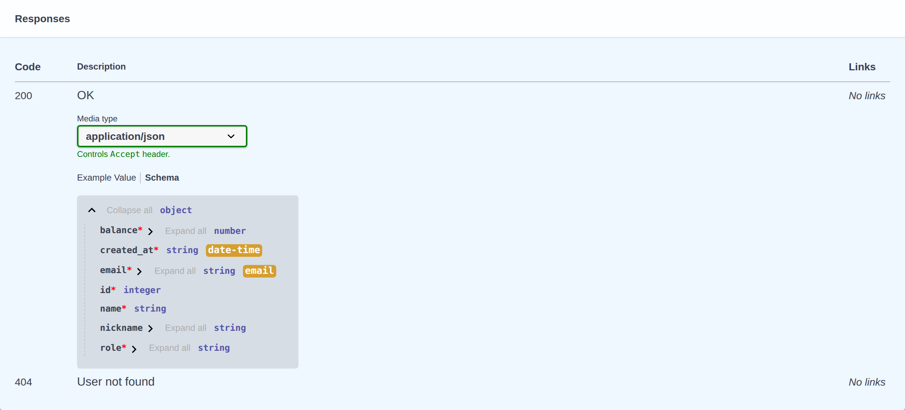

# OpenAPI

OpenAPI middleware for [Fiber](https://github.com/gofiber/fiber) that generates an OpenAPI specification based on the routes registered in your application.

It supports OpenAPI 3.0.x, 3.1.x and 3.2.x. Set `OpenAPIVersion` to a release
such as `"3.0.3"`, `"3.1.0"` (the default) or `"3.2.0"`; `New` panics on any
other value.

## Signatures

```go
func New(config ...Config) fiber.Handler
func Generate(app *fiber.App, config ...Config) ([]byte, error)
func SchemaOf(v any) map[string]any
func Doc(route any) *RouteDoc
func OperationOf(route *fiber.Route) *Operation
func Typed[Req, Res any](router fiber.Router, method, path string, handler func(c fiber.Ctx, req *Req) (*Res, error), options ...TypedOption) *RouteDoc
```

## Examples

### Import

Import the middleware package that is part of the Fiber web framework:

```go
import (
    "github.com/gofiber/fiber/v3"
    "github.com/gofiber/fiber/v3/middleware/openapi"
)
```

### Quick start

Register the middleware after your routes. With the default config it serves the
generated specification at `GET /openapi.json` and a Swagger UI page at
`GET /swagger`:

```go
app.Use(openapi.New())
```

Visiting `/swagger` renders the generated document:



Most of the document exists before a single route is documented: summaries come
from handler names, tags from groups, and responses default to
`application/json`. The helpers below refine those defaults; see
[Behavior and defaults](#behavior-and-defaults) for the rules.

The document is built on the first request and cached. It is rebuilt whenever
the route table changes, so no restart is needed.

### Document metadata

Set top-level information about the API — title, version, contact, license,
servers, tags, external docs and reusable components:

```go
app.Use(openapi.New(openapi.Config{
    Title:          "My API",
    Version:        "1.0.0",
    OpenAPIVersion: "3.1.0", // or "3.0.0", "3.2.0", or a patch release such as "3.1.1"
    Description:    "Example API",
    TermsOfService: "https://example.com/terms",
    Contact:        &openapi.Contact{Name: "API Team", Email: "api@example.com"},
    License:        &openapi.License{Name: "MIT", URL: "https://opensource.org/licenses/MIT"},
    // Servers takes precedence over ServerURL and supports multiple entries.
    Servers: []openapi.Server{
        {URL: "https://prod.example.com", Description: "Production"},
        {URL: "https://staging.example.com", Description: "Staging"},
    },
    // Top-level tag definitions and external documentation.
    Tags:         []openapi.Tag{{Name: "users", Description: "User operations"}},
    ExternalDocs: &openapi.ExternalDocs{Description: "Docs", URL: "https://docs.example.com"},
    // Components holds reusable schema definitions that $ref targets resolve to.
    Components: map[string]any{
        "schemas": map[string]any{
            "User": map[string]any{
                "type": "object",
                "properties": map[string]any{
                    "name":  map[string]any{"type": "string"},
                    "email": map[string]any{"type": "string"},
                },
            },
        },
    },
}))
```

### Authentication (security schemes)

`SecuritySchemes` are emitted under `components.securitySchemes`; `Security` sets
the document-level (default) requirement applied to every operation:

```go
app.Use(openapi.New(openapi.Config{
    SecuritySchemes: map[string]any{
        "bearerAuth": map[string]any{
            "type":         "http",
            "scheme":       "bearer",
            "bearerFormat": "JWT",
        },
    },
    Security: []map[string][]string{
        {"bearerAuth": {}},
    },
}))
```

Each scheme becomes an entry in the UI's **Authorize** dialog:



### Customize the Swagger UI

Change the spec/UI paths and the CDN asset URLs, and pass extra options to the
`SwaggerUIBundle` call:

```go
app.Use(openapi.New(openapi.Config{
    Path:                       "/spec.json",
    UIPath:                     "/docs",
    SwaggerCSSURL:              "https://cdn.example.com/swagger-ui.css",
    SwaggerBundleURL:           "https://cdn.example.com/swagger-ui-bundle.js",
    SwaggerStandalonePresetURL: "https://cdn.example.com/swagger-ui-standalone-preset.js",
    SwaggerOptions: map[string]any{
        "docExpansion": "list",
        "deepLinking":  true,
    },
}))
```

`SwaggerOptions` is merged into the `SwaggerUIBundle` call, so anything Swagger
UI supports works here. With `"filter": true` and `"docExpansion": "full"`, for
example, the page gains a tag filter box and opens every operation on load:



The middleware sets `validatorUrl` to `null` unless you set it, because Swagger
UI's validator badge would otherwise send the document's URL to
`validator.swagger.io`. To serve the assets yourself, see
[Offline and air-gapped deployments](#offline-and-air-gapped-deployments).

### Choose the documentation page

`UI` selects the page served at `UIPath`: `openapi.UISwagger` (the default),
`openapi.UIRedoc` or `openapi.UIScalar`. `DisableUI` serves only the document.

```go
app.Use(openapi.New(openapi.Config{UI: openapi.UIScalar}))
```

Redoc and Scalar each load one script from a pinned CDN URL with a Subresource
Integrity hash. Override it with `RedocBundleURL` or `ScalarBundleURL`, and set
the matching `*Integrity` field, as the default hash fits only the default URL.
The `Swagger*` fields apply to Swagger UI only.

Under a strict Content-Security-Policy, both need the CDN in `script-src` and
`'unsafe-inline'` in `style-src`; neither needs an inline script. Redoc also
wants `worker-src blob:`, and still renders without it.

#### OAuth2 redirect page

Swagger UI's authorization code flow opens a popup that must land on a page of
your origin. Set `OAuth2RedirectPath` and the middleware serves that page and
points Swagger UI at it; register the same path as the redirect URI at your
identity provider. The page has one inline script, which a strict policy can
allow with `openapi.OAuth2RedirectScriptCSPSource`.

### Offline and air-gapped deployments

The document is served by the middleware itself, but the UI page loads its
assets from a CDN by default. In an air-gapped network, or under a strict
`Content-Security-Policy`, those requests fail and the page stays blank. Vendor
the assets and point the config at your copies.

1. Download the pinned version:

   ```bash
   mkdir -p public/swagger-ui
   npm pack swagger-ui-dist@5.32.6
   tar -xzf swagger-ui-dist-5.32.6.tgz
   cp package/swagger-ui.css \
      package/swagger-ui-bundle.js \
      package/swagger-ui-standalone-preset.js \
      public/swagger-ui/
   ```

2. Serve the files and set all three URLs:

   ```go
   //go:embed public/swagger-ui
   var swaggerAssets embed.FS

   func main() {
       assets, err := fs.Sub(swaggerAssets, "public/swagger-ui")
       if err != nil {
           log.Fatal(err)
       }

       app := fiber.New()
       app.Use("/swagger-ui", static.New("", static.Config{FS: assets}))
       app.Use(openapi.New(openapi.Config{
           SwaggerCSSURL:              "/swagger-ui/swagger-ui.css",
           SwaggerBundleURL:           "/swagger-ui/swagger-ui-bundle.js",
           SwaggerStandalonePresetURL: "/swagger-ui/swagger-ui-standalone-preset.js",
       }))
       log.Fatal(app.Listen(":3000"))
   }
   ```

3. Check that the page references nothing external. This should print nothing:

   ```bash
   curl -s http://localhost:3000/swagger | grep -o 'https\?://[^"]*'
   ```

:::caution Override all three
An empty URL means "use the default", not "disable". Any of the three fields you
leave unset still points at the CDN.
:::

For Redoc or Scalar, vendor the one script and set `RedocBundleURL` or
`ScalarBundleURL` the same way.

#### Content-Security-Policy and integrity

- **Inline script**: the Swagger UI page has one inline script, identical on
  every page. Allow it by hash with `openapi.UIScriptCSPSource` instead of
  `'unsafe-inline'`:

  ```go
  c.Set(fiber.HeaderContentSecurityPolicy,
      "script-src 'self' https://unpkg.com "+openapi.UIScriptCSPSource)
  ```

- **Subresource Integrity**: the default URLs carry an `integrity` hash, so a
  browser refuses a file the CDN changed. A URL you override gets no hash
  unless you set the matching `*Integrity` field.
- **Cross-origin assets**: a tag with an `integrity` value also carries
  `crossorigin="anonymous"`, so assets on another origin must send
  `Access-Control-Allow-Origin`.

### Domain routers

The middleware works with [`Domain`](../api/app.md#domain) routers. Register it on a
host and the document and the Swagger UI page answer only for that host, and for
any port on it:

```go
api := app.Domain("api.example.com")
openapi.Doc(api.Get("/pets", listPets)).Summary("List pets")
api.Use(openapi.New())                  // /openapi.json and /swagger on api.example.com only
api.Use("/docs", openapi.New())         // or under a prefix: /docs/openapi.json
api.Group("/v1").Use(openapi.New())     // or in a group of the domain router
api.RouteChain("/openapi.json").Get(openapi.New())
```

A host pattern with parameters, such as `:tenant.example.com`, works the same
way, and each registration has its own `Config`.

Every document describes the whole application, whatever host it is fetched
from; use `Filter` to narrow it. Routes of a domain router carry an
operation-level `servers` entry naming their host, so **Try it out** requests go
to the right place. The documentation helpers, recognized middleware and
`Hidden` work on domain routers as they do on the app.

OpenAPI allows one operation per path and method. When several hosts register
the same one, the document describes the first registration and lists every
host in its `servers`.

### Document a route

Wrap a route's registration in `openapi.Doc` and chain the documentation helpers
on the `*openapi.RouteDoc` it returns. `Doc` takes the result of any
registration — `app.Get(...)`, `group.Post(...)`, `app.Domain(...).Put(...)` or
`app.RouteChain(...).Get(...)` — and panics on any other value. Passed the `App`
or a `Group` itself, it documents that router's latest registration. Every
helper returns the same `*RouteDoc`, so they chain:

```go
openapi.Doc(app.Get("/users/:id", getUser)).
    Summary("Get a user").
    Returns(fiber.StatusOK, User{})
```

Since `Doc` returns its own builder, the chain cannot go on with `Name` or
another registration after a helper. Name the route before wrapping it:

```go
openapi.Doc(app.Get("/users/:id", getUser).Name("getUser")).Summary("Get a user")
```

The shortest way to document a route is to hand it the Go types it already
binds. `Accepts` documents the request body, `Returns` a response and `Params`
the parameters of one location, each from a struct:

```go
type CreateUser struct {
    Name  string `json:"name" validate:"required,min=3"`
    Email string `json:"email" validate:"required,email"`
}

type User struct {
    ID    int    `json:"id"`
    Name  string `json:"name"`
    Email string `json:"email"`
}

type ListFilter struct {
    Page    int `query:"page" validate:"gte=1" openapi:"description:Page number"`
    PerPage int `query:"per_page" validate:"lte=100"`
}

openapi.Doc(app.Post("/users", createUser)).
    Accepts(CreateUser{}).
    Returns(fiber.StatusCreated, User{})

openapi.Doc(app.Get("/users", listUsers)).
    Params(openapi.ParamInQuery, ListFilter{}).
    Returns(fiber.StatusOK, []User{})
```

What the model gives you:

- **Components**: a named struct is emitted once under `components.schemas` and
  referenced with `$ref`, nested structs included. An anonymous struct is
  inlined. Of two types sharing a name, the second is package-qualified
  (`billing.User`).
- **Constraints**: `validate` tags become schema constraints; see
  [Validate rules](#validate-rules).
- **Parameters**: `Params` reads the same `query`, `header`, `cookie` and `uri`
  tags that `Bind` does, and skips fields tagged for another location. An
  explicit `Parameter` of the same name overrides the model.
- **Media types**: `DefaultConsumes` and `DefaultProduces` unless passed
  explicitly. Form media types read `form` tags and XML ones `xml` tags; a
  struct used for several gets one component each (`_form`, `_xml`).
- **Nullability**: pointer fields are nullable, spelled for the document's
  version.

:::caution Maps are raw schemas
A `map[string]any` passed where a schema is expected is used as the schema
itself, not reflected: `Returns(201, map[string]any{"id": 1})` publishes
`{"id": 1}`, which is not a valid schema. Pass a struct or a real schema map.
:::

Any helper that takes a schema accepts a Go value in its place, so
`Parameter("filter", openapi.ParamInQuery, false, ListFilter{}, "")` works too.
The location argument of `Parameter`, `ParameterWithExample` and `Params` is an
`openapi.ParamLocation`: `ParamInPath`, `ParamInQuery`, `ParamInHeader`,
`ParamInCookie` or `ParamInQuerystring`. A constant such as `"query"` converts on
its own, but a plain `string` variable needs `openapi.ParamLocation(s)`. For full
control, `Summary`, `Description`, `RequestBody`, `Parameter`, `Response`,
`Tags`, `Deprecated`, `Produces` and `Consumes` remain, and the `*WithExample`
helpers attach schemas and examples (including `$ref`) explicitly:

```go
openapi.Doc(app.Post("/users", createUser)).
    Summary("Create user").
    Description("Creates a new user").
    RequestBodyWithExample(
        "User payload", true,
        nil, "#/components/schemas/User",
        map[string]any{"name": "alice"},
        map[string]any{"sample": map[string]any{"name": "bob"}},
        fiber.MIMEApplicationJSON,
    ).
    ParameterWithExample(
        "trace-id", "header", true, nil, "",
        "Tracing identifier", "abc-123", map[string]any{"sample": "xyz-789"},
    ).
    ResponseWithExample(
        fiber.StatusCreated, "Created",
        nil, "#/components/schemas/UserResponse",
        map[string]any{"id": 1},
        map[string]any{"sample": map[string]any{"id": 2}},
        fiber.MIMEApplicationJSON,
    ).
    Tags("users", "admin").
    Produces(fiber.MIMEApplicationJSON)
```

Every entry of an `examples` map must be an Example Object in the document. An
entry that already is one (`summary`, `description`, `value`, `externalValue` or a
`$ref`) is used as it is; any other value, such as `"xyz-789"` or
`{"name": "bob"}` above, is wrapped as the `value` of one.

Expanding that operation in the UI shows where each helper lands:



### Per-operation security

Attach security requirements to a single operation. Multiple requirements are
combined with OR, and a route that sets its own requirements is not given any
inferred from the middleware on its path:

```go
openapi.Doc(app.Get("/users", listUsers)).
    Security(map[string][]string{"bearerAuth": {}})
```

Two spellings document a route that is open to everyone, and they differ.
`Security()` with no argument writes `security: []`: the route needs no
authentication, whatever the document-level default or the middleware chain
suggests. An empty requirement, `Security(map[string][]string{})`, writes
`security: [{}]`, which makes authentication optional: a caller may or may not
present credentials.

```go
// Behind a keyauth middleware that skips this route, and public.
openapi.Doc(app.Get("/health", health)).Security()
```

### Advanced parameters

`AddParameter` takes a full `openapi.RouteParameter`, exposing the serialization
fields (`Deprecated`, `Style`, `Explode`, `AllowEmptyValue`, `AllowReserved`) that
the simpler `Parameter`/`ParameterWithExample` helpers do not:

```go
explode := false
openapi.Doc(app.Get("/items", listItems)).
    AddParameter(openapi.RouteParameter{
        Name:    "ids",
        In:      "query",
        Style:   "form",
        Explode: &explode,
        Schema:  map[string]any{"type": "array", "items": map[string]any{"type": "string"}},
    })
```

### Path parameter constraints

Path parameters are derived from the route pattern, and a
[route constraint](../guide/routing.md#constraints) narrows the generated schema
automatically — no `AddParameter` call needed:

```go
app.Get("/users/:id<int>", getUser)                  // {"type": "integer"}
app.Get("/orders/:ref<guid>", getOrder)              // {"type": "string", "format": "uuid"}
app.Get("/pages/:n<range(1,10)>", getPage)           // {"type": "integer", "minimum": 1, "maximum": 10}
```

| Constraint | Generated schema |
| --- | --- |
| `int` | `{"type": "integer"}` |
| `bool` | `{"type": "boolean"}` |
| `float` | `{"type": "number"}` |
| `alpha` | `{"type": "string"}` |
| `guid` | `{"type": "string", "format": "uuid"}` |
| `datetime(layout)` | `{"type": "string"}`, plus `format` for the `date`, `time` and `date-time` layouts |
| `regex(p)` | `{"type": "string", "pattern": "p"}`, published as written and checked by clients against one path segment; a pattern containing `/` is left out, as no segment can match it |
| `minLen(n)` / `maxLen(n)` / `len(n)` / `betweenLen(a,b)` | `{"type": "string"}` with `minLength` / `maxLength` |
| `min(n)` / `max(n)` / `range(a,b)` | `{"type": "integer"}` with `minimum` / `maximum` |

The UI renders the derived schema:



Chained constraints (`:id<int;min(5)>`) are merged, and a custom constraint
leaves `{"type": "string"}`. An explicit `AddParameter` schema for the same name
wins.

The length constraints count bytes at runtime, while `minLength`/`maxLength`
count characters, so the bound is approximate for non-ASCII values.

### Response headers

`ResponseHeader(status, name, description, schema)` documents a response header
for a given status code, creating the response entry if it does not exist yet:

```go
openapi.Doc(app.Post("/users", createUser)).
    Response(fiber.StatusCreated, "Created", fiber.MIMEApplicationJSON).
    ResponseHeader(fiber.StatusCreated, "Location", "URL of the created user", map[string]any{"type": "string"})
```

### Response links

`ResponseLink(status, name, link)` documents an OpenAPI link for a response:

```go
openapi.Doc(app.Post("/users", createUser)).
    Response(fiber.StatusCreated, "Created", fiber.MIMEApplicationJSON).
    ResponseLink(fiber.StatusCreated, "getUserById", map[string]any{
        "operationId": "getUsersId",
        "parameters":  map[string]any{"id": "$response.body#/id"},
    })
```

### The `default` response

A status of `0` addresses the OpenAPI `default` response — the one that applies
to any status code not listed explicitly. Every status-taking helper accepts it:

```go
openapi.Doc(app.Get("/users", listUsers)).
    Response(fiber.StatusOK, "OK", fiber.MIMEApplicationJSON).
    ResponseWithExample(
        0, "Unexpected error",
        nil, "#/components/schemas/Error", nil, nil,
        fiber.MIMEApplicationJSON,
    ).
    ResponseHeader(0, "X-Request-Id", "Correlation id", map[string]any{"type": "string"})
```

An empty description keeps the one an earlier call set, or else uses the status
text (`"OK"`, `"Not Found"`, or `"Default response"` for `0`). A later call for
the same status keeps its headers and links, and replaces its body only when it
documents a new schema or example.

### Per-media-type content

`RequestBodyContent` and `ResponseContent` accept a map of media type to
`openapi.RouteMediaType`, so each content type can carry a different schema, example
and `encoding`:

```go
openapi.Doc(app.Post("/users", createUser)).
    RequestBodyContent("User payload", true, map[string]openapi.RouteMediaType{
        fiber.MIMEApplicationJSON: {Schema: openapi.SchemaOf(User{})},
        fiber.MIMEApplicationXML:  {SchemaRef: "#/components/schemas/User"},
    }).
    ResponseContent(fiber.StatusCreated, "Created", map[string]openapi.RouteMediaType{
        fiber.MIMEApplicationJSON: {Schema: openapi.SchemaOf(User{})},
    })
```

The UI offers one entry per media type:



:::note XML examples
Give an XML schema an [XML Object](https://spec.openapis.org/oas/v3.1.0#xml-object)
(`"xml": map[string]any{"name": "invoice"}`) naming the root element. Without it
Swagger UI has no element name to build from and renders a placeholder comment
instead of an example.
:::

`RouteParameter.Content` does the same for a parameter whose value is not a plain
scalar — for example a JSON-encoded query parameter. A Parameter Object carries
either `schema` or `content` and never both, so setting `Content` discards any
`Schema`/`SchemaRef` on the same parameter:

```go
openapi.Doc(app.Get("/users", listUsers)).
    AddParameter(openapi.RouteParameter{
        Name: "filter",
        In:   "query",
        Content: map[string]openapi.RouteMediaType{
            fiber.MIMEApplicationJSON: {Schema: openapi.SchemaOf(Filter{})},
        },
    })
```

### Operation external docs & extensions

`OperationExternalDocs` sets the operation's `externalDocs` and panics on an
empty URL, which the External Documentation Object requires, and
`OperationExtension` shallow-merges any other operation-object fields (such as
`servers`, `callbacks` or `x-*` extensions) without clobbering generated keys:

```go
openapi.Doc(app.Get("/users", listUsers)).
    OperationExternalDocs("More info", "https://docs.example.com/list-users").
    OperationExtension(map[string]any{
        "servers": []any{map[string]any{"url": "https://users.example.com"}},
    })
```

### Typed routes

Handlers are plain functions, so the middleware cannot read the types a handler
works with. `openapi.Typed` registers a route from them instead: the handler
takes its request as a struct, returns its response as a struct, and the route is
documented from the two types.

```go
type GetUser struct {
    ID     int    `uri:"id"`
    Expand string `query:"expand"`
    Token  string `header:"X-Token"`
    Name   string `json:"name" validate:"required"` // a body field
}

openapi.Typed(app, fiber.MethodPost, "/users/:id", func(c fiber.Ctx, req *GetUser) (*User, error) {
    return loadUser(req)
}, openapi.WithStatus(fiber.StatusCreated)).Summary("Update a user")
```

The route documents the fields tagged `uri`, `query`, `header` and `cookie` as
parameters, the others as the request body (not for `GET`, `HEAD`, `TRACE`,
`OPTIONS` and `CONNECT`), and `*User` as the success response.

- **Binding**: each field is filled only from the source it is tagged for.
  Unlike `c.Bind().All`, a field is never matched by its Go name in another
  source, so a client cannot set a body field such as `IsAdmin` with a header,
  a cookie or a query parameter. A request that does not bind or validate gets
  a `400`.
- **Response**: written as JSON with the status from `WithStatus` (`200` by
  default). `Empty` as the response type answers with no body (`204` by default).
- **Options**: `WithMiddleware` runs handlers before the typed one. `Typed`
  returns the route's `*RouteDoc`, so `Summary`, `Tags` and the other helpers
  chain on it.

A struct used as a request body leaves out its parameter-only fields. If that
makes it differ from the same type used as a response, the body gets its own
component with a `_request` suffix.

### Operation id, callbacks and servers

`OperationID` sets the `operationId` of a route, which otherwise comes from its
`Name` or its method and path; an id another operation already uses gets a numeric
suffix. `Callback` documents a callback by name with a Callback Object, and
`OperationServer` adds a Server Object (a map with a `url`) to the operation,
replacing the servers the document or a [`Domain` router](#domain-routers) would
give it; a route with servers of its own is not widened by another host that
shares its path.

```go
openapi.Doc(app.Post("/files", upload)).
    OperationID("uploadFile").
    Callback("done", map[string]any{
        "{$request.body#/callbackUrl}": map[string]any{
            "post": map[string]any{"responses": map[string]any{"200": map[string]any{"description": "Received"}}},
        },
    }).
    OperationServer(map[string]any{"url": "https://uploads.example.com", "description": "Upload hosts"})
```

### Several documents from one app

`Filter` keeps a route in the document when it returns `true`, so one app can
serve a public and an internal document, or one per version. It receives a copy of
each route and runs for the routes the middleware documents, not for `Use`
routes, so a kept route keeps the security its middleware implies. A route the
filter drops leaves no schema or security scheme behind.

```go
public := openapi.New(openapi.Config{
    Title:  "Public API",
    Filter: func(r *fiber.Route) bool { return !strings.HasPrefix(r.Path, "/internal") },
})
app.Group("/docs").Use(public)
app.Group("/internal-docs", auth).Use(openapi.New(openapi.Config{Title: "Internal API"}))
```

### Read a route's documentation

What the helpers of `openapi.Doc` record is stored on the route as an
`openapi.Operation` (with the fields `Summary`, `Description`, `Consumes`,
`Produces`, `Responses`, `RequestBody`, `Parameters`, `ParameterModels`, `Tags`,
`Security`, `ExternalDocs`, `OperationExtensions`, `Callbacks`, `Servers`,
`OperationID`, `Deprecated` and `Hidden`). `openapi.OperationOf(route)` returns
it, or `nil` for a route that was never documented. The `Operation` is shared
with every copy of the route, so read it but do not modify it. A `Filter` can
use it to build a document from the tags a route was given:

```go
partners := openapi.New(openapi.Config{
    Title: "Partner API",
    Filter: func(r *fiber.Route) bool {
        op := openapi.OperationOf(r)
        return op != nil && slices.Contains(op.Tags, "partners")
    },
})
```

`openapi.OperationOf(r) != nil && openapi.OperationOf(r).Hidden` reports whether
`Hidden` excluded a route.

### Generate the document without serving it

`Generate` returns the document of an app, encoded with the app's JSON encoder,
without starting a server: write it to a file in CI, diff it against the last
release or feed a client generator. It prepares the app the way serving does, so
mounted apps are included, and builds the document byte for byte as `New` serves
it for the same config.

```go
data, err := openapi.Generate(app, openapi.Config{Title: "Pets", Version: "2.1.0"})
if err != nil {
    log.Fatal(err)
}
_ = os.WriteFile("openapi.json", data, 0o644)
```

YAML is not generated; convert the JSON with a tool of your choice.

### Edit the finished document

`Extensions` adds `x-` fields to the document root and `InfoExtensions` to the
`info` object (`New` panics on a key that does not start with `x-`). For anything
else, `Transform` receives the finished document as a generic map before it is
encoded; change it in place, or return an error to fail the request. It runs on
a fresh copy for every build and numbers arrive as `json.Number`.

```go
app.Use(openapi.New(openapi.Config{
    Extensions:     map[string]any{"x-logo": map[string]any{"url": "https://example.com/logo.png"}},
    InfoExtensions: map[string]any{"x-audience": "partners"},
    Transform: func(doc map[string]any) error {
        doc["x-generated"] = time.Now().UTC().Format(time.RFC3339)
        return nil
    },
}))
```

### Defaults for a group of routes

`openapi.Doc(group)` documents that group's latest registration, not every
route of the group, so something common to every route under a prefix goes in
`Defaults`:

```go
app.Use(openapi.New(openapi.Config{
    ErrorSchema: Problem{},
    Defaults: []openapi.Defaults{{
        PathPrefix: "/api/v1",
        Tags:       []string{"v1"},
        Security:   []map[string][]string{{"company": {}}},
        Parameters: []openapi.RouteParameter{{Name: "X-Tenant", In: openapi.ParamInHeader, Required: true}},
        Responses: map[int]openapi.RouteResponse{
            fiber.StatusTooManyRequests: {Description: "Too many requests"},
            0:                           {Description: "Unexpected error"}, // the default response
        },
    }},
}))
```

An entry applies to the routes under `PathPrefix`, at a segment boundary. What
a route declares itself wins, and with several entries the first one that sets
something wins. `ErrorSchema` also fills a declared `4xx` or `5xx` response that
documents no body.

### Path item fields

`PathItems` adds a summary, a description and parameters shared by every method
of a path, keyed by its OpenAPI path:

```go
app.Use(openapi.New(openapi.Config{PathItems: map[string]openapi.PathItem{
    "/pets/{id}": {Summary: "A pet", Parameters: []openapi.RouteParameter{{Name: "X-Region", In: openapi.ParamInHeader}}},
}}))
```

A path the document does not contain is ignored.

### Request bodies on GET and HEAD

A `GET` or `HEAD` route documents no request body, as RFC 9110 gives it no
meaning (and `TRACE` never has one). `DocumentGetBodies` documents the body of a
`GET` or `HEAD` route anyway, for an API that reads one.

### Hide a route

`Hidden()` excludes a route from the generated specification entirely — useful for
internal or admin endpoints:

```go
openapi.Doc(app.Get("/internal/metrics", metricsHandler)).Hidden()
```

### QUERY routes (OpenAPI 3.2)

The HTTP `QUERY` method maps to the OpenAPI `query` operation, which exists only
in OpenAPI 3.2. Register the route with `app.Query(...)` and select 3.2; it
documents like any other operation (and, unlike `GET`, may carry a request body):

```go
app.Use(openapi.New(openapi.Config{OpenAPIVersion: "3.2.0"}))

openapi.Doc(app.Query("/search", searchHandler)).
    Summary("Search").
    RequestBody("Search criteria", true, fiber.MIMEApplicationJSON)
```

When `OpenAPIVersion` is `3.0.0` or `3.1.0`, `QUERY` routes are omitted from the
spec because those versions cannot represent the operation.

### Custom HTTP methods (OpenAPI 3.2)

A route for a method that has no Path Item field (`PURGE`, `LINK`, `CONNECT`, or
any entry of the app's `RequestMethods`) is written under the path's
`additionalOperations`, keyed by the method as registered. That exists only in
3.2; with `3.0.x` and `3.1.x` these routes are omitted from the document.

```go
app := fiber.New(fiber.Config{RequestMethods: append(fiber.DefaultMethods[:len(fiber.DefaultMethods):len(fiber.DefaultMethods)], "PURGE")})
openapi.Doc(app.Add([]string{"PURGE"}, "/cache/:key", purge)).Summary("Purge a cache entry")
app.Use(openapi.New(openapi.Config{OpenAPIVersion: "3.2.0"}))
```

### Streaming responses (OpenAPI 3.2)

A sequential media type (`text/event-stream`, `application/jsonl`,
`application/x-ndjson`) is read item by item. `ItemSchema` of a media type entry
describes each item; 3.2 writes it as `itemSchema`, and earlier versions get the
equivalent array schema (`type: array`, `items`) unless `Schema` is set:

```go
openapi.Doc(app.Get("/events", events)).ResponseContent(fiber.StatusOK, "A stream of events", map[string]openapi.RouteMediaType{
    "text/event-stream": {ItemSchema: Event{}},
})
```

### Tag metadata (OpenAPI 3.2)

`Tag` also has `Summary`, `Parent` and `Kind`, written for 3.2 only. `Parent`
must name another tag of `Tags`; `New` panics otherwise.

### OpenAPI 3.2 document fields

3.2 adds a few typed fields the middleware emits when `OpenAPIVersion` is
`"3.2.0"` (and `License.Identifier` for 3.1+):

```go
app.Use(openapi.New(openapi.Config{
    OpenAPIVersion: "3.2.0",
    Self:           "https://example.com/openapi.json", // $self
    License:        &openapi.License{Name: "Apache 2.0", Identifier: "Apache-2.0"},
    Servers: []openapi.Server{
        {URL: "https://api.example.com", Name: "production"}, // Server.name
    },
}))
```

A parameter may also use the 3.2 `querystring` location, which describes the whole
query string as a single value. That location is only valid with `content`, so the
middleware wraps whatever `Schema` you supply (defaulting to `{"type": "string"}`)
into an `application/x-www-form-urlencoded` entry. Set `Content` explicitly to pick
a different media type:

```go
openapi.Doc(app.Get("/search", searchHandler)).
    AddParameter(openapi.RouteParameter{Name: "q", In: "querystring", Schema: map[string]any{"type": "string"}})

openapi.Doc(app.Get("/report", reportHandler)).
    AddParameter(openapi.RouteParameter{
        Name: "q",
        In:   "querystring",
        Content: map[string]openapi.RouteMediaType{
            fiber.MIMEApplicationJSON: {Schema: map[string]any{"type": "object"}},
        },
    })
```

`querystring` parameters are dropped from the document when `OpenAPIVersion` is
below `"3.2.0"`, where the location does not exist.

Other 3.2 additions, such as the device-authorization flow and
`components.mediaTypes`, need no special API: supply them through `Components`
or `SecuritySchemes`.

### Validation

The documentation helpers reject arguments that could only produce an invalid
document, and they do it at registration time — a panic during startup rather
than a malformed spec served in production:

| Helper | Panics when |
|:-------|:------------|
| `Consumes`, `Produces`, `RequestBody*`, `Response*`, `RequestBodyContent`, `ResponseContent` | a media type is not a parseable `type/subtype` |
| `Parameter*`, `AddParameter` | the name is empty, `In` is not `path`/`query`/`header`/`cookie`/`querystring`, or `Content` holds more than one media type |
| `Response*`, `ResponseHeader`, `ResponseLink`, `ResponseContent` | the status is outside 100–599 (`0` is allowed and means `default`) |
| `ResponseHeader`, `ResponseLink` | the header or link name is empty |

Passing an empty string to `Consumes`/`Produces` is not an error: it clears the
route's media type.

### Behavior and defaults

Anything a route sets explicitly wins over what is described here.

#### What is filled in for you

- **Responses**: a route that declares none gets `200 OK`, or `204 No Content`
  for `DELETE`. Declaring any response turns this off.
- **Summary**: derived from the handler's function name, so `listUsers` becomes
  `List users` and `(*Server).GetUserByID` becomes `Get user by ID`. A closure
  falls back to `"METHOD /path"`. This puts Go function names in a public
  document; set `DisableHandlerSummaries` if they are internal.
- **Tags**: taken from the enclosing group: the last segment of its name
  (`Name("users.")` tags `users`), or else the last static segment of its
  prefix, skipping parameters and version markers (`/api/v1/users` tags
  `users`). The innermost group wins, and a route on the app itself gets no
  tag. `DisableGroupTags` turns this off. Tags that operations use are declared
  at the top level automatically.
- **Media types**: a response without one documents `DefaultProduces`, and a
  request body the route's `Consumes`, then `DefaultConsumes`. A status without
  a body (`1xx`, `204`, `205`, `304`) gets no content, and a request body is
  never invented. `DisableDefaultMediaTypes` turns the defaults off.
- **`operationId`**: `OperationID`, else the route's `Name` (characters other
  than letters, digits, `_`, `-` and `.` become `_`), else the method and path
  (`GET /users/{id}` → `getUsersId`). A duplicate gets a numeric suffix.
- **Validation errors**: with a `StructValidator` configured, a route that
  declares a body or parameters gets a `400`. `DisableValidationResponses`
  turns this off.
- **Error bodies**: inferred error responses use `ErrorProduces` and
  `ErrorSchema`, which should match your app's error handler.

#### Recognized middleware

Fiber middleware among a route's handlers, or registered with `Use` ahead of it
on a prefix that covers its path, documents itself:

| Middleware | Adds to the operation |
|:-----------|:----------------------|
| `keyauth`, `gofiber/contrib/v3/jwt` | a `bearerAuth` requirement and scheme, and a `401` with `WWW-Authenticate` |
| `basicauth` | a `basicAuth` requirement and scheme, and a `401` with `WWW-Authenticate` |
| `csrf` | a required `X-Csrf-Token` header and a `403`, on unsafe methods |
| `limiter` | the `X-RateLimit-*` headers on `2xx` responses, and a `429` with `Retry-After` |
| `requestid` | the `X-Request-ID` response header |
| `etag` | an `ETag` header on the `200`, and a `304` on `GET` and `HEAD` |
| `cache` | the `X-Cache` response header |
| `idempotency` | an optional `X-Idempotency-Key` header, on unsafe methods |
| `session` | an optional `session_id` cookie and the `Set-Cookie` response header |
| `responsetime` | the `X-Response-Time` response header |
| `cors` | the `Access-Control-Allow-Origin` response header |
| `compress` | the `Content-Encoding` response header |
| `timeout` | a `503` |
| `recover` | a `500` |
| `earlydata` | a `425 Too Early`, on unsafe methods |
| `healthcheck` | its `200` and `503` answers, as the handler of a route |

- **Custom names**: a middleware's configuration cannot be read from its
  handler. If yours differs from the defaults above, repeat it in the config:
  `KeyAuthLookup` (a key read from a header, a query parameter or a cookie
  becomes an `apiKeyAuth` scheme), `CSRFHeader`, `RateLimitHeaders` or
  `DisableRateLimitHeaders`, `RequestIDHeader`, `CacheHeader`,
  `IdempotencyKeyHeader`, `SessionLookup`, `ResponseTimeHeader` and
  `HealthcheckProduces`.
- **Skipped routes**: a middleware's own `Next` function is not visible, so a
  recognized middleware is documented as always applying. Return `false` from
  `InferMiddleware` to leave one out for a route, or give the route an explicit
  `Security()`:

  ```go
  openapi.Config{InferMiddleware: func(r *fiber.Route, name string) bool {
      return !(name == openapi.MiddlewareKeyAuth && r.Path == "/health")
  }}
  ```

- **Precedence**: an explicit `Security(...)` replaces every inferred
  authentication detail, the `401` included. Headers and responses a route
  documents itself are kept.
- **Coverage**: a `Use` prefix covers a route only when every request the route
  answers passes it, so `/admin` covers `/admin/x` but not `/administrators`.
  Middleware on a `Domain` router covers the routes of that host.
- **Your own middleware**: only the middleware of the `fiber` module is
  recognized by default, not a fork or a package of yours. Describe yours in
  `Middleware` with one instance of its handler, and every handler that
  constructor builds is recognized:

  ```go
  app.Use(openapi.New(openapi.Config{Middleware: []openapi.MiddlewareDoc{{
      Handler:         tenantauth.New(),
      Name:            "tenantauth",
      SecuritySchemes: map[string]any{"tenantAuth": map[string]any{"type": "apiKey", "in": "header", "name": "X-Tenant-Key"}},
      Security:        map[string][]string{"tenantAuth": {}},
      Responses:       map[int]openapi.RouteResponse{fiber.StatusUnauthorized: {Description: "Unknown tenant key"}},
      ResponseHeaders: map[string]any{"X-Tenant": "The tenant the request was served for"},
  }}}))
  ```

  A `MiddlewareDoc` can also add `Parameters`. `Middleware` holds at most 50
  entries.

`DisableMiddlewareInference` turns all of this off.

#### Paths and parameters

- A wildcard (`*`, `+`) becomes a path parameter named `wildcard<n>`:
  `/files/*` documents as `/files/{wildcard1}`, plus `/files` since `*` also
  matches nothing. Pass that name to `AddParameter` to describe it.
- Optional parameters emit one path per level: `/files/:dir?/:name?` documents
  `/files`, `/files/{dir}` and `/files/{dir}/{name}`, up to 64 variants per
  route.
- A trailing slash is dropped (`/a/` is published as `/a`), except under
  `StrictRouting`.
- A literal `{` or `}` in a route is published percent-encoded.
- A header parameter named `Accept`, `Content-Type` or `Authorization` is left
  out, as OpenAPI ignores those; media types and security schemes describe them.
- A `querystring` parameter (3.2) and `query` parameters cannot share an
  operation. In 3.2 the `query` ones are dropped without a warning; before 3.2
  the `querystring` one is.

#### Methods

- Every registered method is documented, so `app.All` yields one operation per
  method. The `HEAD` route Fiber derives from each `GET` is omitted; an explicit
  `app.Head(...)` is documented, and should be given the `GET`'s `Produces`.
- `GET` and `HEAD` operations have no request body unless `DocumentGetBodies`
  is set, and `TRACE` never has one.
- `QUERY`, `CONNECT` and custom methods appear only in 3.2 documents.

#### Groups, sub-apps and domains

- `openapi.Doc` on a `Group`, `RouteChain` or `Domain` router documents that
  router's latest registration, and its helpers do nothing before its first one.
- A sub-app's routes are copied into the parent when the app starts (or when
  `Domain(...).Use` is called), so document them in the sub-app, before that.
  The mount (`app.Use("/api", subApp)`) is not a route of its own, so there is
  nothing on it to document.
- The document describes the whole application, wherever the middleware is
  registered. Use `Filter` to narrow it.
- Registering the same method and path twice in a row merges the handlers into
  one route, documented by the latest registration.

#### Serving

- The middleware answers only `GET` and `HEAD`. The document is built on the
  first request, cached, and rebuilt when the route table changes.
- The document and the UI page carry an `ETag` and `Cache-Control: no-cache`, so
  clients revalidate and refetch only after a change.
- Generating the document while routes are being registered is safe.
- `New` panics on a `Servers` entry the specification rejects (a variable
  without a `Default`, a `Default` outside its `Enum`, or an undeclared `{name}`
  in the URL) and when `Path` equals `UIPath`.
- OpenAPI 3.0 allows no keys beside a `$ref`, so a described reference is
  written as `{"allOf": [{"$ref": …}], "description": …}` there.

## Config

| Property | Type | Description | Default |
|:---|:---|:---|:---|
| Next | `func(fiber.Ctx) bool` | Skips the middleware when it returns `true`. | `nil` |
| Title | `string` | Document title. | `"Fiber API"` |
| Version | `string` | API version. | `"1.0.0"` |
| Description | `string` | API description. | `""` |
| ServerURL | `string` | Server URL; `Servers` takes precedence. | `""` |
| Path | `string` | Route of the document. | `"/openapi.json"` |
| UIPath | `string` | Route of the documentation page. | `"/swagger"` |
| SwaggerCSSURL | `string` | Swagger UI stylesheet URL. | `"https://unpkg.com/swagger-ui-dist@5.32.6/swagger-ui.css"` |
| SwaggerBundleURL | `string` | Swagger UI script URL. | `"https://unpkg.com/swagger-ui-dist@5.32.6/swagger-ui-bundle.js"` |
| SwaggerStandalonePresetURL | `string` | Swagger UI standalone preset URL; always loaded. | `"https://unpkg.com/swagger-ui-dist@5.32.6/swagger-ui-standalone-preset.js"` |
| SwaggerCSSIntegrity | `string` | Integrity hash for `SwaggerCSSURL`; defaults only with the default URL. | the hash of the default stylesheet |
| SwaggerBundleIntegrity | `string` | Integrity hash for `SwaggerBundleURL`. | the hash of the default bundle |
| SwaggerStandalonePresetIntegrity | `string` | Integrity hash for `SwaggerStandalonePresetURL`. | the hash of the default preset |
| SwaggerOptions | `map[string]any` | Options merged into the `SwaggerUIBundle` call. | `nil` |
| OpenAPIVersion | `string` | Any 3.0.x, 3.1.x or 3.2.x release; `New` panics on anything else. | `"3.1.0"` |
| Components | `map[string]any` | Reusable definitions emitted under `components`. | `nil` |
| SecuritySchemes | `map[string]any` | Emitted under `components.securitySchemes`. | `nil` |
| Security | `[]map[string][]string` | Document-level requirements, ORed. An empty non-nil list means no authentication. | `nil` |
| Contact | `*Contact` | `info.contact`. | `nil` |
| License | `*License` | `info.license`. | `nil` |
| TermsOfService | `string` | `info.termsOfService`. | `""` |
| Servers | `[]Server` | Servers hosting the API, with optional `Variables`. | `nil` |
| Tags | `[]Tag` | Top-level tag definitions. | `nil` |
| ExternalDocs | `*ExternalDocs` | `externalDocs`. | `nil` |
| Summary | `string` | `info.summary` (3.1+). | `""` |
| Webhooks | `map[string]any` | `webhooks` (3.1+). | `nil` |
| JSONSchemaDialect | `string` | `jsonSchemaDialect` (3.1+). | `""` |
| Self | `string` | `$self` (3.2). | `""` |
| DefaultProduces | `string` | Media type of a response that declares none. | `"application/json"` |
| DefaultConsumes | `string` | Media type of a request body that declares none. | `"application/json"` |
| ErrorProduces | `string` | Media type of inferred error responses. | `"text/plain; charset=utf-8"`, or `"application/json"` when `ErrorSchema` is set |
| ErrorSchema | `any` | Schema, or Go value, of those error responses. | `nil` |
| DisableDefaultMediaTypes | `bool` | Leaves a response or body without a media type without content. | `false` |
| DisableMiddlewareInference | `bool` | Stops documenting recognized middleware. | `false` |
| DisableValidationResponses | `bool` | Stops documenting the `400` of a `StructValidator`. | `false` |
| RequestIDHeader | `string` | Header the `requestid` middleware sets. | `"X-Request-ID"` |
| CacheHeader | `string` | Header the `cache` middleware sets. | `"X-Cache"` |
| CSRFHeader | `string` | Header the `csrf` middleware reads its token from. | `"X-Csrf-Token"` |
| IdempotencyKeyHeader | `string` | Header the `idempotency` middleware reads its key from. | `"X-Idempotency-Key"` |
| SessionLookup | `*APIKeyLookup` | Where `session` keeps its ID: `In` is `cookie` or `header`. | `nil` (a `session_id` cookie) |
| HealthcheckProduces | `string` | Media type of the `healthcheck` answer. | `"text/plain; charset=utf-8"` |
| ResponseTimeHeader | `string` | Header the `responsetime` middleware sets. | `"X-Response-Time"` |
| KeyAuthLookup | `*APIKeyLookup` | Where `keyauth` reads its key: `In` is `header`, `query` or `cookie`. | `nil` (a bearer token) |
| InferMiddleware | `func(*fiber.Route, string) bool` | Returns `false` to leave a recognized middleware off a route. | `nil` |
| Middleware | `[]MiddlewareDoc` | Describes middleware of your own. | `nil` |
| Filter | `func(*fiber.Route) bool` | Keeps a route when it returns `true`. | `nil` |
| Transform | `func(map[string]any) error` | Edits the finished document. | `nil` |
| Extensions | `map[string]any` | `x-` fields on the document root. | `nil` |
| InfoExtensions | `map[string]any` | `x-` fields on `info`. | `nil` |
| PathItems | `map[string]PathItem` | Summary, description and parameters of a path, keyed by OpenAPI path. | `nil` |
| Defaults | `[]Defaults` | Tags, security, parameters and responses by path prefix. | `nil` |
| UI | `UI` | `UISwagger`, `UIRedoc` or `UIScalar`. | `UISwagger` |
| DisableUI | `bool` | Serves only the document. | `false` |
| OAuth2RedirectPath | `string` | Route of Swagger UI's OAuth2 redirect page. | `""` |
| RedocBundleURL | `string` | Redoc script URL. | `"https://unpkg.com/redoc@2.5.0/bundles/redoc.standalone.js"` |
| RedocBundleIntegrity | `string` | Integrity hash for `RedocBundleURL`. | the hash of the default bundle |
| ScalarBundleURL | `string` | Scalar script URL. | `"https://cdn.jsdelivr.net/npm/@scalar/api-reference@1.81.0/dist/browser/standalone.min.js"` |
| ScalarBundleIntegrity | `string` | Integrity hash for `ScalarBundleURL`. | the hash of the default bundle |
| TypeSchemas | `map[reflect.Type]any` | Schema of your choice for a Go type, written inline. | `nil` |
| SchemaName | `func(reflect.Type) string` | Names a model's component; `""` keeps the default. | `nil` |
| DocumentGetBodies | `bool` | Documents `GET` and `HEAD` request bodies. | `false` |
| RateLimitHeaders | `RateLimitHeaders` | Headers the `limiter` middleware sets. | `X-RateLimit-Limit`, `X-RateLimit-Remaining`, `X-RateLimit-Reset` |
| DisableRateLimitHeaders | `bool` | Stops documenting the limiter headers; the `429` stays. | `false` |
| DisableGroupTags | `bool` | Stops tagging routes from their group. | `false` |
| DisableHandlerSummaries | `bool` | Stops deriving summaries from handler names. | `false` |

Fields marked 3.1+ or 3.2 are left out of older documents, as are `Server.Name`
(3.2) and `License.Identifier` (3.1+). A License with both `Identifier` and
`URL` keeps the one its version supports.

`Path`, `UIPath` and `OAuth2RedirectPath` resolve against the mount prefix:
`app.Group("/v1").Use(openapi.New())` serves `/v1/openapi.json` and `/v1/swagger`,
while a global `app.Use(openapi.New())` answers only `/openapi.json` and
`/swagger`. A prefix may have parameters: `app.Use("/:tenant?", openapi.New())`
serves `/acme/openapi.json` and `/openapi.json`. A trailing slash (`/swagger/`)
also matches, except under `StrictRouting`.

The middleware can also be pinned to one route, such as
`app.Get("/openapi.json", openapi.New())`. That serves only the document, so the
UI page needs its own registration.

## Default Config

```go
var ConfigDefault = Config{
    Title:                      "Fiber API",
    Version:                    "1.0.0",
    Path:                       "/openapi.json",
    UIPath:                     "/swagger",
    OpenAPIVersion:             "3.1.0",
    UI:                         openapi.UISwagger,
    SwaggerCSSURL:              "https://unpkg.com/swagger-ui-dist@5.32.6/swagger-ui.css",
    SwaggerBundleURL:           "https://unpkg.com/swagger-ui-dist@5.32.6/swagger-ui-bundle.js",
    SwaggerStandalonePresetURL: "https://unpkg.com/swagger-ui-dist@5.32.6/swagger-ui-standalone-preset.js",
    RedocBundleURL:             "https://unpkg.com/redoc@2.5.0/bundles/redoc.standalone.js",
    ScalarBundleURL:            "https://cdn.jsdelivr.net/npm/@scalar/api-reference@1.81.0/dist/browser/standalone.min.js",
    // Each default URL also has its Subresource Integrity hash in the matching *Integrity field.
    DefaultProduces:            "application/json",
    DefaultConsumes:            "application/json",
    ErrorProduces:              "text/plain; charset=utf-8",
    RequestIDHeader:            "X-Request-ID",
    CacheHeader:                "X-Cache",
    CSRFHeader:                 "X-Csrf-Token",
    IdempotencyKeyHeader:       "X-Idempotency-Key",
    ResponseTimeHeader:         "X-Response-Time",
    HealthcheckProduces:        "text/plain; charset=utf-8",
    RateLimitHeaders: openapi.RateLimitHeaders{
        Limit:     "X-RateLimit-Limit",
        Remaining: "X-RateLimit-Remaining",
        Reset:     "X-RateLimit-Reset",
    },
}
```

A field left at its zero value falls back to its default, so an empty string
never means "disable".

A `SchemaRef` is emitted as a `$ref`, so define its target under `Components`.
When both `Example` and `Examples` are given, `Examples` wins, as OpenAPI allows
only one.

## Automatic Schema Inference

A Go value passed to `Accepts`, `Returns`, `Params` or any helper that takes a
schema is reflected into a JSON Schema. `SchemaOf` exposes the same reflection,
except that it inlines nested structs instead of referencing components and
leaves pointer fields non-nullable. Given a struct:

```go
type User struct {
    ID    int    `json:"id"`
    Name  string `json:"name"`
    Email string `json:"email" openapi:"format:email,description:User email address"`
}
```

Use the generated schema directly in the route helpers:

```go
openapi.Doc(app.Post("/users", createUser)).
    RequestBodyWithExample("Create user", true, openapi.SchemaOf(User{}), "", nil, nil, fiber.MIMEApplicationJSON).
    ResponseWithExample(201, "Created", openapi.SchemaOf(User{}), "", nil, nil, fiber.MIMEApplicationJSON)
```

The **Schema** tab beside each example renders what reflection produced:



Or register it once under `Components` and reference it with `$ref` reuse:

```go
app.Use(openapi.New(openapi.Config{
    Components: map[string]any{
        "schemas": map[string]any{
            "User": openapi.SchemaOf(User{}),
        },
    },
}))
```

### Supported types

| Go type | OpenAPI type |
|:--------|:-------------|
| `string` | `string` |
| `bool` | `boolean` |
| `int`, `int8`–`int64`, `uint`–`uint64` | `integer` |
| `float32`, `float64` | `number` |
| `time.Time` | `string` (format: `date-time`) |
| `[]byte` | `string` (format: `byte`, base64) |
| `[]T` / `[N]T` | `array` (items: schema of `T`) |
| `map[string]T` | `object` (additionalProperties: schema of `T`) |
| `map[K]T` with a non-string key | `object` (no `additionalProperties`) |
| struct | `object` (properties from fields) |
| `*multipart.FileHeader` (or a slice of it) | `string` (format: `binary`), a file upload |
| `*T` | schema of `T` (field not included in `required`) |
| `any` / `interface{}` | `{}` (accepts any value) |
| `json.Number` | `number` (a string kind that marshals as a bare number) |
| implements `json.Marshaler` | `{}` (custom output cannot be predicted) |
| implements `encoding.TextMarshaler` | `string` |

Embedded structs are flattened into the parent with the conflict rules of
`encoding/json`. A recursive struct becomes a bare `{"type": "object"}` where the
cycle repeats, and fields with no JSON representation are skipped.

### Struct field tags

- **`json:"name"`** — sets the property name; `json:"-"` skips the field
- **`json:",omitempty"`** and **`json:",omitzero"`** — make the field optional
  (not in `required`)
- **`json:",string"`** — documents the field as `string`
- **`openapi:"description:text"`** — sets the property description
- **`openapi:"example:value"`** — sets the property example (auto-converted to the correct type)
- **`openapi:"format:fmt"`** — sets the format (e.g., `email`, `uuid`, `date-time`)
- **`openapi:"enum:a|b|c"`** — sets allowed enum values (pipe-separated)
- **`openapi:"default:value"`** (converted to the field's type), **`openapi:"pattern:regex"`**,
  **`openapi:"title:text"`** and **`openapi:"multipleOf:n"`** set the keyword of the same name;
  **`openapi:"uniqueItems"`** marks a list whose items must differ; **`openapi:"nullable"`**
  allows `null`
- **`openapi:"x-name:value"`** adds an extension to the property; a value that is JSON
  (`5`, `true`, `[1,2]`, `{"a":1}`) is kept as such and anything else as text
- **`openapi:"readOnly"`**, **`openapi:"writeOnly"`** and **`openapi:"deprecated"`**
  — set the flag of the same name
- **`validate:"..."`** — the rules a `StructValidator` enforces become
  constraints; see [Validate rules](#validate-rules)

Multiple `openapi` directives can be combined with commas:

```go
type Product struct {
    Status string `json:"status" openapi:"enum:active|inactive,description:Product status"`
}
```

A value may contain commas and colons. Only a comma directly followed by another
directive key or flag starts the next directive, so `description:Sorted, title:x`
sets a description and a title.

A struct whose fields carry examples gets an object-level `example` assembled
from them, nested models included, so Swagger UI shows a value for the model
rather than its shape.

### Validate rules

| Rule | Schema |
|:-----|:-------|
| `required` | the property is required, even with `omitempty` |
| `min`, `max`, `len`, `gte`, `lte` | `minimum`/`maximum` for numbers, `minLength`/`maxLength` for strings, `minItems`/`maxItems` for lists, `minProperties`/`maxProperties` for maps |
| `gt`, `lt` | the same, one step inside the limit (ignored on floats) |
| `oneof=a b` | `enum`; `'two words'` is one value |
| `eq=v`, `ne=v` | a one-value `enum`, a `not` |
| `unique` | `uniqueItems` on a list |
| `port` | an integer from 1 to 65535 |
| `email`, `uuid`, `url`, `uri`, `ipv4`, `ipv6`, `hostname`, `base64`, RFC 3339 `datetime` | `format`, unless the `openapi` tag set one |
| `startswith`, `endswith`, `contains`, `alpha`, `alphanum`, `numeric`, `number`, `hexadecimal`, `hexcolor`, `e164`, `ascii`, `jwt` | `pattern`; a schema holds one, so the first rule wins |
| `required_with`, `required_with_all`, `required_without`, `required_without_all`, `required_if`, `required_unless` | `if`/`then` or `dependentRequired` entries under `allOf`, in 3.1+ documents only |

The tag's structure is followed: rules after `dive` apply to the elements, rules
between `keys` and `endkeys` are skipped, and after `omitempty` the rules an
empty value would break (`min`, `gte`, `gt`, `len`, `oneof`) are left out. A
`[]byte` gets base64 character counts, a number quoted with `json:",string"`
gets no bounds, and a rule the schema cannot express is ignored.

### Describing the struct itself

A blank field tagged `openapi` sets what the object says about itself: `title`,
`description`, `deprecated`, an `x-` extension, or an `example` that is JSON and
replaces the assembled one.

```go
type Pet struct {
    _    struct{} `openapi:"title:Pet,description:A pet in the shop,x-resource:pets"`
    Name string   `json:"name"`
}
```

### Types that describe themselves

Reflection cannot know that a decimal is written as a string, or that an ID has a
shape. A type that implements `openapi.SchemaProvider` returns its own schema
(from a value or a pointer receiver, called on a zero value); a named struct
becomes a component like any model. For a type you cannot add a method to, such
as `time.Duration`, `Config.TypeSchemas` maps a Go type to a schema, written
inline and winning over the provider and over the built-in mapping:

```go
func (Money) OpenAPISchema() map[string]any {
    return map[string]any{"type": "string", "pattern": `^-?\d+(\.\d+)?$`, "example": "12.50"}
}

app.Use(openapi.New(openapi.Config{TypeSchemas: map[reflect.Type]any{
    reflect.TypeFor[time.Duration](): map[string]any{"type": "integer", "format": "int64", "description": "nanoseconds"},
}}))
```

A Go value in a schema position of the returned map (an item of `oneOf`, `anyOf`
or `allOf`, `items`, `properties`, a `discriminator` mapping) is replaced by its
type's schema, so a provider can stand for one of several types. `openapi.OneOf`,
`AnyOf`, `AllOf` and `WithDiscriminator` build those maps:

```go
func (Pet) OpenAPISchema() map[string]any {
    return openapi.WithDiscriminator(
        openapi.OneOf(Cat{}, Dog{}), "kind",
        map[string]any{"cat": Cat{}, "dog": Dog{}}, // mapped to references to the Cat and Dog components
    )
}
```

A discriminator mapping can only name structs (which are components); with
`SchemaOf`, which has no components, the models are inlined and the mapping keeps
only the entries that are already references.

### Component names

A struct is named after its Go type, then qualified by its package, then numbered
on a clash. `Config.SchemaName` picks the name instead: return `""` to keep the default
for a type. A chosen name is numbered on a clash, and is restricted to the
characters a component name allows.

### XML bodies

A media type of `application/xml`, `text/xml` or ending in `+xml` is described by
`xml` tags instead of `json` ones, as a form media type is by `form` tags (the
component is named with an `_xml` suffix): `xml:"name"` names the property,
`xml:",attr"` marks an attribute, `xml:"items>item"` a list wrapped in an element,
`xml:"-"` skips the field and `omitempty` makes it optional. An `XMLName xml.Name`
field with a tag names the root element. Fields that are no element of their own
(`,any`, `,comment` and `,innerxml`) are left out.
